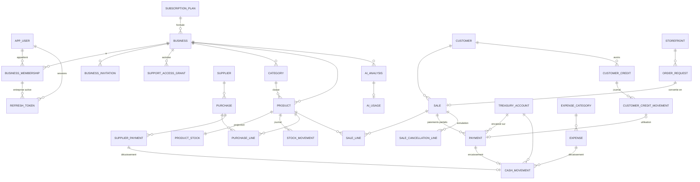

# FOOYRE — Modèle de données (PostgreSQL)

Version : 0.3 (Phase 0 consolidée — 2026-11-18) · Statut : **modèle cible intégrant les décisions D1 à D20** (colonnes liées aux points ouverts O7, O9, O11 marquées « provisoire ») — le schéma définitif sera créé par migrations Flyway, module par module, à partir de la phase 2.

## 1. Conventions

| Sujet | Règle |
|---|---|
| Nommage | `snake_case`, tables au singulier (`sale`, `sale_line`) |
| Clé primaire | `id UUID` généré par l'application |
| Tenant | `business_id UUID NOT NULL` sur toute table métier + FK vers `business` |
| Intégrité inter‑tenant | contrainte `UNIQUE (business_id, id)` sur chaque table métier ; FK **composites** `(business_id, xxx_id) → xxx(business_id, id)` |
| Montants | `NUMERIC(19,2)` · coûts unitaires et CMP `NUMERIC(19,4)` · quantités `NUMERIC(19,3)` · taux `NUMERIC(5,2)` ; les montants sont arrondis à l'échelle de la devise avant stockage (XOF : 0 décimale, `cahier-des-charges.md` §3.2) |
| Devise | `CHAR(3) NOT NULL` ISO 4217 au niveau de `business` (D6, `XOF` initialement) ; recopiée sur `sale`, `payment`, `expense`, `purchase` pour figer l'historique |
| Horodatage | `created_at`, `updated_at TIMESTAMPTZ NOT NULL` ; dates métier en `DATE` |
| Auteur | `created_by UUID` (utilisateur) sur les écritures métier |
| Verrouillage optimiste | `version INTEGER NOT NULL DEFAULT 0` sur les entités éditables |
| Énumérations | `VARCHAR` + `CHECK` (plus simple à faire évoluer que les types `ENUM` PostgreSQL) |
| Suppression | pas de `DELETE` métier : `archived_at` (référentiels) ou statut `CANCELLED` (transactions) |
| Journaux | `stock_movement`, `payment`, `cash_movement`, `customer_credit_movement`, `sale_cancellation_line`, `audit_log` : insertion seule (droits `UPDATE/DELETE` retirés au rôle applicatif) |
| Datation des corrections (D13) | toute annulation ou correction porte sa propre date (`cancellation_date`, `voided_at`, `paid_at` du remboursement…) ; aucune colonne de date ou de montant d'une écriture antérieure n'est modifiée |
| Idempotence durable | `idempotency_key` + `UNIQUE (business_id, idempotency_key)` (index partiel `WHERE idempotency_key IS NOT NULL`) sur `sale`, `payment`, `customer`, `expense` (ADR‑09, ADR‑14) |
| Fichiers | colonnes `*_key` = clé d'objet dans le stockage de fichiers, jamais une URL propre à un fournisseur (ADR‑15) |
| RLS | activée sur toutes les tables portant `business_id` : `USING (business_id = current_setting('app.business_id')::uuid)` (lectures **et** écritures, `WITH CHECK` identique) |
| Données personnelles | téléphones, emails et noms de clients jamais copiés dans `audit_log.details`, `ai_analysis.input_snapshot` ni les logs ; les adresses IP sont stockées hachées |

## 2. Diagramme entité‑relation (simplifié)

## 3. Tables

### 3.1 Identité et tenants

**`app_user`** — compte utilisateur (global, non rattaché à un tenant)
| Colonne | Type | Notes |
|---|---|---|
| id | UUID PK | |
| email | VARCHAR(254) | unique (insensible à la casse, `citext` ou index `lower()`) |
| phone | VARCHAR(20) | optionnel, format E.164 |
| password_hash | VARCHAR(255) | Argon2id / bcrypt |
| full_name | VARCHAR(150) | |
| locale | VARCHAR(10) NOT NULL | défaut `fr` ; limitée aux locales prises en charge (D16) |
| platform_admin | BOOLEAN | défaut `false` |
| status | VARCHAR(20) | `ACTIVE`, `LOCKED`, `DISABLED` |
| security_version | INTEGER | incrémenté pour invalider les jetons |
| failed_login_count, locked_until | INTEGER, TIMESTAMPTZ | anti‑force brute |
| last_login_at, created_at, updated_at | TIMESTAMPTZ | |

**`refresh_token`** — un enregistrement par jeton émis (ADR‑04) : `id`, `user_id` FK, `business_id` et `membership_id` (entreprise active de la session), `family_id` (= identifiant de session `sid`), `token_hash` (SHA‑256, unique ; le jeton en clair n'est jamais stocké), `expires_at`, `replaced_by`, `replaced_at` (fenêtre de tolérance), `revoked_at`, `revocation_reason` (`LOGOUT`, `LOGOUT_ALL`, `PASSWORD_CHANGED`, `REUSE_DETECTED`, `MEMBERSHIP_REVOKED`, `ACCOUNT_DISABLED`, `BUSINESS_SUSPENDED`), `created_at`, `user_agent`, `ip_hash`. Index `(user_id, revoked_at)`, `(family_id)`.

**`password_reset_token`** — `id`, `user_id`, `token_hash` (unique), `expires_at` (courte durée), `used_at`, `created_at`, `ip_hash`. Usage unique.

**`subscription_plan`** — formules **paramétrables** (D10) : `id`, `code` unique (exemples non validés : `FREE`, `ESSENTIAL`, `PRO`, `BUSINESS`), `name`, `active`, `max_users`, `max_products`, `ai_monthly_analyses`, `ai_monthly_cost_cap_usd NUMERIC(12,2)`, `features JSONB` (fonctionnalités activées : rapports, catalogue digital…), `display_price_note` (texte indicatif facultatif, **aucun tarif validé**), timestamps, version. *(aucune donnée de paiement)*

**`business`** — le tenant
| Colonne | Type | Notes |
|---|---|---|
| id | UUID PK | |
| name | VARCHAR(150) | |
| legal_name, ninea, rccm | VARCHAR | identifiants légaux sénégalais, optionnels |
| phone, email, address | | |
| currency | CHAR(3) NOT NULL | défaut `XOF` ; non modifiable dès qu'une transaction existe |
| timezone | VARCHAR(50) | défaut `Africa/Dakar` |
| default_locale | VARCHAR(10) NOT NULL | défaut `fr` (D16) ; information générale modifiable par OWNER et MANAGER |
| vat_enabled | BOOLEAN NOT NULL | défaut `false` (D4) |
| price_entry_mode | VARCHAR(3) NOT NULL | `HT` ou `TTC` (D4) ; `CHECK` ; défaut `TTC` proposé (sans effet tant que la TVA est désactivée) |
| default_vat_rate | NUMERIC(5,2) NOT NULL | défaut `18.00`, configurable, `CHECK (0 ≤ taux ≤ 100)` |
| allow_negative_stock | BOOLEAN NOT NULL | défaut `false` (D5) |
| employee_max_discount_rate | NUMERIC(5,2) NOT NULL | limite de remise des employés (D14), modifiable par OWNER et MANAGER ; **forme provisoire (O11)** : pourcentage maximal de la remise totale par rapport au montant brut de la vente ; défaut `0` (aucune remise) ; `CHECK (0 ≤ taux ≤ 100)` |
| plan_id | UUID FK | formule courante |
| max_users_override, max_products_override, ai_monthly_analyses_override | INTEGER | dérogations par entreprise (nullable = valeur de la formule) |
| ai_monthly_cost_cap_usd_override | NUMERIC(12,2) | idem |
| ai_enabled | BOOLEAN NOT NULL | opt‑in IA de l'entreprise, défaut `false` (D15) |
| ai_consent_at, ai_consent_by, ai_terms_version | TIMESTAMPTZ, UUID, VARCHAR(20) | trace du dernier consentement du propriétaire |
| ai_consent_revoked_at, ai_consent_revoked_by | TIMESTAMPTZ, UUID | dernière révocation ; l'historique complet est dans `audit_log` (`AI_CONSENT_CHANGED`) |
| status | VARCHAR(20) | `ACTIVE`, `SUSPENDED`, `CLOSED` |
| created_at, updated_at, version | | |

Toute modification des paramètres sensibles (fiscaux, stock, devise) et de la limite de remise est journalisée dans `audit_log` (ancienne et nouvelle valeur). Les paramètres sensibles ne sont modifiables que par `BUSINESS_OWNER` ; `BUSINESS_MANAGER` les lit sans les modifier (D20).

**`business_membership`** — `id`, `business_id`, `user_id`, `role` (`BUSINESS_OWNER`, `BUSINESS_MANAGER`, `EMPLOYEE`), `status` (`ACTIVE`, `REVOKED`), `invited_by`, `revoked_at`, `revoked_by`, timestamps, version. `UNIQUE (business_id, user_id)`. Au moins un `BUSINESS_OWNER` actif par entreprise (contrôle applicatif + test).

**`business_invitation`** — `id`, `business_id`, `email` ou `phone`, `role`, `token_hash` (unique), `invited_by`, `expires_at`, `accepted_at`, `accepted_by_user_id`, `revoked_at`, `created_at`. L'acceptation crée la `business_membership`.

**`business_sequence`** — `business_id`, `sequence_name` (`RECEIPT`, `PURCHASE`, `ORDER_REQUEST`, `CREDIT_NOTE`), `year`, `next_value`. PK `(business_id, sequence_name, year)`. Verrouillée `FOR UPDATE` lors de l'attribution.

### 3.2 GESTION

**`category`** — `id`, `business_id`, `name`, `parent_id` (FK composite, 1 niveau), `archived_at`, timestamps. `UNIQUE (business_id, lower(name), parent_id)`.

**`product`**
| Colonne | Type | Notes |
|---|---|---|
| id, business_id | UUID | |
| category_id | UUID | FK composite, nullable |
| name | VARCHAR(150) | |
| sku | VARCHAR(64) | `UNIQUE (business_id, sku)` si renseigné |
| barcode | VARCHAR(64) | |
| unit | VARCHAR(20) | `PIECE`, `KG`, `LITRE`, `METRE`, `PACK`… |
| sale_price | NUMERIC(19,2) | ≥ 0 ; interprété HT ou TTC selon `business.price_entry_mode` |
| average_cost | NUMERIC(19,4) | CMP courant (D1), ≥ 0, nullable si inconnu ; modifié uniquement par le service de stock |
| vat_rate | NUMERIC(5,2) | nullable → taux de l'entreprise |
| low_stock_threshold | NUMERIC(19,3) | |
| track_stock | BOOLEAN | `false` pour services |
| publicly_visible | BOOLEAN | catalogue digital |
| public_description, image_key | TEXT, VARCHAR | `image_key` : clé d'objet (ADR‑15) |
| archived_at, timestamps, version | | |

**`product_stock`** — projection : `business_id`, `product_id` (PK composite), `quantity NUMERIC(19,3)`, `updated_at`. Mise à jour uniquement par le service de stock, dans la transaction du mouvement, sous verrou `SELECT … FOR UPDATE`. Si `allow_negative_stock = false`, le service refuse tout mouvement qui rendrait la quantité négative.

**`stock_movement`** — journal immuable ; toute correction = mouvement compensatoire
| Colonne | Type | Notes |
|---|---|---|
| id, business_id, product_id | UUID | |
| type | VARCHAR(30) | `INITIAL`, `PURCHASE_IN`, `PURCHASE_CANCEL_OUT`, `SALE_OUT`, `SALE_CANCEL_IN`, `ADJUSTMENT_IN`, `ADJUSTMENT_OUT` ; `CUSTOMER_RETURN_IN` réservé (retours partiels hors MVP) |
| quantity | NUMERIC(19,3) | signée (+ entrée / − sortie), ≠ 0 |
| unit_cost | NUMERIC(19,4) | coût de valorisation du mouvement (coût d'achat HT, CMP courant, ou coût figé de la ligne de vente) |
| balance_after | NUMERIC(19,3) | quantité après mouvement (contrôle) |
| average_cost_after | NUMERIC(19,4) | CMP après mouvement (traçabilité du recalcul) |
| reference_type, reference_id | VARCHAR, UUID | `SALE`, `PURCHASE`, `ADJUSTMENT` |
| compensates_movement_id | UUID | mouvement d'origine pour les compensations |
| reason | VARCHAR(255) | obligatoire pour les ajustements et compensations |
| occurred_at, created_by, created_at | | |

**`supplier`** — `id`, `business_id`, `name`, `contact_name`, `phone`, `email`, `address`, `notes`, `archived_at`, timestamps, version.

**`purchase`** (approvisionnement / réception) — `id`, `business_id`, `supplier_id` (nullable), `number`, `purchase_date`, `status` (`DRAFT`, `RECEIVED`, `CANCELLED`), `total_amount` (HT si TVA activée), `amount_paid` (projection des paiements fournisseurs valides), `currency`, `received_at`, `cancelled_at`, `cancellation_reason`, `notes`, timestamps, version.
**`purchase_line`** — `id`, `business_id`, `purchase_id`, `product_id`, `quantity`, `unit_cost NUMERIC(19,4)` (HT si TVA activée), `line_total`.
**`supplier_payment`** — `id`, `business_id`, `purchase_id`, `amount`, `currency`, `method`, `treasury_account_id`, `paid_at`, `status` (`VALID`, `VOIDED`), `void_reason`, `created_by`, `created_at`. Chaque paiement valide génère un `cash_movement` sortant ; une contre‑passation génère un mouvement `REVERSAL`. *(peut être implémenté après la phase 4)*

**`customer`** — `id`, `business_id`, `name`, `phone`, `email`, `address`, `notes`, `idempotency_key` (création éventuellement hors ligne, unicité durable), `archived_at`, timestamps, version. Le solde dû et les avoirs disponibles sont **calculés**, non stockés (ou stockés comme projections vérifiables).

### 3.3 COMMERCE

**`sale`**
| Colonne | Type | Notes |
|---|---|---|
| id, business_id | UUID | |
| number | VARCHAR(30) | numéro de reçu séquentiel, `UNIQUE (business_id, number)`, attribué à la confirmation |
| customer_id | UUID | FK composite, nullable (vente comptoir anonyme) |
| channel | VARCHAR(20) | `COUNTER`, `PHONE`, `WHATSAPP`, `STOREFRONT`, `OTHER` |
| status | VARCHAR(20) | `DRAFT`, `CONFIRMED`, `CANCELLED` (le statut `COMPLETED` est supprimé : paiement et livraison sont des dimensions séparées) |
| fulfillment_status | VARCHAR(20) | `NONE`, `TO_DELIVER`, `DELIVERED` (commandes) |
| sale_date | DATE | date métier (base des ventes brutes) ; une date antérieure à la date d'enregistrement est journalisée (O9) |
| cancellation_date | DATE | date métier de l'annulation, fuseau de l'entreprise (base des annulations de la période — D13) ; obligatoire pour toute vente `CANCELLED` (contrainte `CHECK` ci‑dessous) ; pour un brouillon annulé, elle est renseignée mais sans effet sur les indicateurs (un brouillon n'est jamais compté dans les ventes brutes) |
| origin | VARCHAR(20) | `ONLINE`, `OFFLINE_SYNC` (saisie hors ligne synchronisée — D17) |
| client_created_at | TIMESTAMPTZ | horodatage déclaré par l'appareil pour une saisie hors ligne ; informatif, non fiable |
| currency | CHAR(3) | |
| vat_enabled, price_entry_mode | BOOLEAN, VARCHAR(3) | **photographie** des paramètres de l'entreprise à la confirmation (D4) |
| subtotal_amount | NUMERIC(19,2) | Σ montants nets de ligne avant remise globale |
| discount_amount | NUMERIC(19,2) | remise globale (ventilée sur les lignes) |
| tax_amount | NUMERIC(19,2) | Σ TVA des lignes ; 0 si TVA désactivée |
| total_amount | NUMERIC(19,2) | Σ TTC des lignes = montant dû |
| net_revenue_amount | NUMERIC(19,2) | Σ HT des lignes → base du CA |
| cost_amount | NUMERIC(19,2) | Σ CMV figé des lignes |
| amount_paid | NUMERIC(19,2) | projection : Σ `PAYMENT` valides (toutes méthodes, y compris avoir) − Σ `REFUND` valides − Σ `CREDIT_CONVERSION` valides |
| payment_status | VARCHAR(20) | `UNPAID`, `PARTIALLY_PAID`, `PAID`, `REFUNDED` (dérivé de `amount_paid`) ; `REFUNDED` = vente annulée dont le montant payé a été entièrement restitué, par remboursement et/ou avoir (D11) ; un état « trop‑perçu » n'est pas atteignable (paiements excédentaires refusés, règle provisoire O7 : remboursements + avoir = montant payé) |
| confirmed_at, cancelled_at | TIMESTAMPTZ | |
| cancellation_reason | VARCHAR(255) | obligatoire si annulée |
| cancelled_by, created_by | UUID | |
| order_request_id | UUID | si issue du catalogue |
| idempotency_key | UUID | |
| notes, timestamps, version | | |

Contraintes : `CHECK (total_amount >= 0)`, `CHECK (amount_paid >= 0 AND amount_paid <= total_amount)`, `CHECK (status <> 'CANCELLED' OR (cancellation_reason IS NOT NULL AND cancellation_date IS NOT NULL))`, `CHECK (status = 'DRAFT' OR number IS NOT NULL OR status = 'CANCELLED')`, `UNIQUE (business_id, idempotency_key)` (partiel). Le verrou `SELECT … FOR UPDATE` sur la vente précède toute confirmation, paiement, remboursement ou annulation.

**`sale_line`** — photographie historique figée à la confirmation (D1, D4) : `id`, `business_id`, `sale_id`, `product_id`, `product_name` (instantané), `quantity NUMERIC(19,3) > 0`, `catalog_unit_price` (prix catalogue au moment de la vente), `unit_price NUMERIC(19,2)` (prix appliqué, saisi selon `price_entry_mode`), `price_overridden BOOLEAN`, `discount_amount` (remise de ligne), `allocated_global_discount`, `vat_rate`, `line_net_amount` (HT), `line_tax_amount`, `line_total_amount` (TTC), `unit_cost NUMERIC(19,4)` (CMP figé, nullable si inconnu), `line_cost_amount`. Aucune colonne n'est modifiable après confirmation.

**`sale_cancellation_line`** (D11) — insertion seule, créée à l'annulation d'une vente confirmée : `id`, `business_id`, `sale_id`, `sale_line_id`, `quantity`, `unit_cost` (coût figé de la ligne), `restocked BOOLEAN` (produit retourné revendable ⇒ mouvement `SALE_CANCEL_IN`), `stock_movement_id` (si réintégré), `created_by`, `created_at`. Le coût des lignes non réintégrées n'est pas déduit du CMV ; leur présentation comptable relève d'O8.

**`payment`** — journal des encaissements clients
| Colonne | Type | Notes |
|---|---|---|
| id, business_id, sale_id | UUID | |
| customer_id | UUID | dénormalisé pour l'historique client |
| type | VARCHAR(20) | `PAYMENT`, `REFUND`, `CREDIT_CONVERSION` (montant payé converti en avoir lors d'une annulation — D11) |
| amount | NUMERIC(19,2) | > 0 (le signe est porté par `type`) |
| currency | CHAR(3) | |
| method | VARCHAR(20) | `CASH`, `WAVE`, `ORANGE_MONEY`, `FREE_MONEY`, `BANK_TRANSFER`, `CARD`, `CUSTOMER_CREDIT` (règlement par avoir), `OTHER` ; nul pour `CREDIT_CONVERSION` |
| treasury_account_id | UUID | compte crédité/débité ; **nul** pour `CREDIT_CONVERSION` et pour la méthode `CUSTOMER_CREDIT` (aucun mouvement de trésorerie) |
| customer_credit_id | UUID | avoir utilisé (`CUSTOMER_CREDIT`) ou créé (`CREDIT_CONVERSION`) |
| external_reference | VARCHAR(100) | n° de transaction mobile money (saisi) |
| paid_at | TIMESTAMPTZ | date d'encaissement |
| status | VARCHAR(20) | `VALID`, `VOIDED` (erreur de saisie, avec motif et contre‑passation) |
| void_reason, voided_at, voided_by | | |
| idempotency_key, created_by, created_at | | `UNIQUE (business_id, idempotency_key)` (partiel) ; les lignes créées par une annulation n'ont pas de clé propre (l'annulation est protégée par le contrôle d'état sous verrou) |

**`customer_credit`** (avoir client — D11) — `id`, `business_id`, `customer_id` (**NOT NULL** : un avoir exige un client identifié), `number` (séquence `CREDIT_NOTE`, `UNIQUE (business_id, number)`), `origin_sale_id`, `amount NUMERIC(19,2) > 0`, `remaining_amount` (projection, `0 ≤ remaining_amount ≤ amount`), `currency`, `status` (`OPEN`, `EXHAUSTED`), `issued_at`, `expires_at` (nullable — **provisoire**, aucune expiration tant qu'O7 n'est pas tranché), `reason`, `created_by`, timestamps, version. Verrouillé `FOR UPDATE` lors de toute utilisation.

**`customer_credit_movement`** — journal immuable de l'avoir : `id`, `business_id`, `customer_credit_id`, `type` (`ISSUE`, `USE`, `USE_REVERSAL` — contre‑passation d'un paiement par avoir), `amount > 0`, `payment_id`, `occurred_at`, `created_by`. Aucun mouvement de trésorerie associé.

### 3.4 FINANCE

**`treasury_account`** — `id`, `business_id`, `name`, `type` (`CASH`, `MOBILE_MONEY`, `BANK`), `provider` (`WAVE`, `ORANGE_MONEY`…), `opening_balance`, `opening_date`, `archived_at`, timestamps.

**`cash_movement`** — grand livre de trésorerie, immuable
| Colonne | Type | Notes |
|---|---|---|
| id, business_id, treasury_account_id | UUID | |
| direction | VARCHAR(3) | `IN`, `OUT` |
| amount | NUMERIC(19,2) | > 0 |
| source_type | VARCHAR(30) | `CUSTOMER_PAYMENT` (IN, jamais pour un règlement par avoir), `CUSTOMER_REFUND` (OUT), `EXPENSE` (OUT), `SUPPLIER_PAYMENT` (OUT), `TRANSFER` (OUT + IN), `OWNER_CONTRIBUTION` (IN), `OWNER_WITHDRAWAL` (OUT), `ADJUSTMENT`, `REVERSAL` (sens opposé au mouvement annulé) |
| source_id | UUID | |
| reverses_movement_id | UUID | pour `REVERSAL` |
| occurred_at | TIMESTAMPTZ | |
| description, created_by, created_at | | |

**`expense_category`** — `id`, `business_id`, `name`, `system_code` (catégories proposées par défaut), `archived_at`.

**`expense`** — `id`, `business_id`, `category_id`, `supplier_id` (optionnel), `label`, `amount`, `currency`, `expense_date`, `payment_status` (`PAID`, `UNPAID`), `paid_at`, `method`, `treasury_account_id`, `status` (`ACTIVE`, `CANCELLED`), `cancellation_reason`, `cancellation_date` (date métier de l'annulation — D13), `attachment_key` (clé d'objet — ADR‑15), `idempotency_key` (unicité durable), timestamps, version.

### 3.5 COMMERCE DIGITAL

**`storefront`** — `id`, `business_id` (unique), `slug` (unique global, `[a-z0-9-]{3,60}`), `enabled`, `display_name`, `description`, `whatsapp_phone`, `show_availability`, timestamps.

**`order_request`** — `id`, `business_id`, `storefront_id`, `number`, `customer_name`, `customer_phone`, `message`, `status` (`NEW`, `CONTACTED`, `CONVERTED`, `REJECTED`, `SPAM`), `converted_sale_id`, `ip_hash`, `created_at`, `handled_by`, `handled_at`.
**`order_request_line`** — `id`, `business_id`, `order_request_id`, `product_id`, `product_name`, `quantity`, `unit_price_displayed`.

### 3.6 INTELLIGENCE

**`ai_analysis`** — `id`, `business_id`, `requested_by`, `analysis_type` (`PERFORMANCE_OVERVIEW`, `PRODUCT_PROFITABILITY`, `STOCK_RISK`, `CUSTOM_QUESTION`), `period_start`, `period_end`, `input_snapshot JSONB` (données pseudonymisées envoyées), `output JSONB` (réponse structurée validée), `status` (`SUCCEEDED`, `FAILED`, `REJECTED_INVALID_OUTPUT`, `QUOTA_EXCEEDED`), `error_code`, `prompt_version`, `created_at`.

**`ai_usage`** — `id`, `business_id`, `analysis_id`, `model`, `input_tokens`, `output_tokens`, `cache_read_tokens`, `cache_write_tokens`, `estimated_cost_usd NUMERIC(12,6)`, `price_table_version`, `latency_ms`, `stop_reason`, `request_id` (identifiant Anthropic), `created_at`. Agrégé par entreprise et par mois pour les quotas et plafonds.

### 3.7 Accès support

**`support_access_grant`** (D7, D12) — `id`, `business_id`, `requested_by` (administrateur plateforme), `reason` (obligatoire), `requested_scope` et `granted_scope` (`TEXT[]` de domaines : `CATALOG`, `STOCK`, `SALES`, `CUSTOMERS`, `FINANCE`…), `requested_duration_hours`, `access_mode` (`READ_ONLY` par défaut, `READ_WRITE` uniquement si accordé explicitement), `status` (`REQUESTED`, `GRANTED`, `REJECTED`, `REVOKED`, `EXPIRED`), `granted_by` (**obligatoirement** un `BUSINESS_OWNER` actif de l'entreprise — contrôle applicatif + test), `granted_at`, `expires_at` (`CHECK expires_at > granted_at`, durée plafonnée), `revoked_at`, `revoked_by`, `created_at`. `granted_scope` ⊆ `requested_scope`. Chaque requête effectuée sous cet octroi est tracée dans `audit_log` avec `support_grant_id`.

### 3.8 Transverse

**`idempotency_record`** — `business_id`, `idempotency_key`, `endpoint`, `request_hash`, `response_status`, `response_body JSONB`, `created_at`, `expires_at`. PK `(business_id, idempotency_key)`.

**`audit_log`** — `id`, `business_id` (nullable pour actions plateforme), `actor_user_id`, `support_grant_id` (si action sous accès support), `action` (`LOGIN`, `BUSINESS_SWITCHED`, `SESSION_REVOKED`, `TOKEN_REUSE_DETECTED`, `ROLE_CHANGED`, `SETTINGS_CHANGED`, `SALES_POLICY_CHANGED`, `DISCOUNT_APPLIED`, `DISCOUNT_LIMIT_EXCEEDED`, `SALE_BACKDATED`, `SALE_CANCELLED`, `REFUND_CREATED`, `CREDIT_ISSUED`, `CREDIT_USED`, `STOCK_ADJUSTED`, `SUPPORT_ACCESS_REQUESTED`, `SUPPORT_ACCESS_GRANTED`, `SUPPORT_ACCESS_REJECTED`, `SUPPORT_ACCESS_REVOKED`, `SUPPORT_ACCESS_USED`, `AI_CONSENT_CHANGED`, `OFFLINE_SYNC_TENANT_MISMATCH`…), `target_type`, `target_id`, `details JSONB` (sans secret ni donnée personnelle de client), `ip_hash`, `occurred_at`. Insertion seule.

## 4. Invariants métier (vérifiés par tests)

1. `sale.amount_paid = Σ payment(VALID, PAYMENT) − Σ payment(VALID, REFUND) − Σ payment(VALID, CREDIT_CONVERSION)` pour la vente, et `0 ≤ amount_paid ≤ total_amount` ; une vente annulée après confirmation a `amount_paid = 0` (règle provisoire O7).
2. `product_stock.quantity = Σ stock_movement.quantity` pour le produit ; si l'entreprise n'autorise pas le stock négatif, `quantity ≥ 0`.
3. Une vente `CONFIRMED` possède un mouvement `SALE_OUT` pour chaque ligne suivie en stock ; une vente `CANCELLED` précédemment confirmée possède une `sale_cancellation_line` par ligne suivie en stock et un mouvement `SALE_CANCEL_IN` exactement pour celles où `restocked = true` ; une vente annulée à l'état de brouillon n'a aucun mouvement.
4. Les totaux d'une vente sont la somme de ses lignes arrondies : `net_revenue_amount = Σ line_net_amount`, `tax_amount = Σ line_tax_amount`, `total_amount = Σ line_total_amount`, `cost_amount = Σ line_cost_amount`.
5. Chaque `payment` valide de type `PAYMENT` ou `REFUND` dont la méthode n'est pas `CUSTOMER_CREDIT`, chaque `supplier_payment` valide et chaque `expense` payée a exactement un `cash_movement` correspondant (et un mouvement `REVERSAL` en cas de contre‑passation ou d'annulation) ; les paiements `CREDIT_CONVERSION` et par avoir n'en ont **aucun** ; le solde d'un compte de trésorerie = solde d'ouverture + Σ IN − Σ OUT.
6. Aucune ligne d'une table métier ne référence une ligne d'un autre `business_id` (garanti par les FK composites).
7. `product.average_cost` = `average_cost_after` du dernier mouvement valorisé du produit.
8. Au moins un `BUSINESS_OWNER` actif par entreprise.
9. `customer_credit.remaining_amount = Σ ISSUE − Σ USE + Σ USE_REVERSAL` et `0 ≤ remaining_amount ≤ amount` ; un avoir n'est utilisé que pour une vente du même client et de la même entreprise.
10. Aucune clé d'idempotence n'apparaît deux fois pour une même entreprise sur `sale`, `payment`, `customer` ou `expense` (rejeux hors ligne sans doublon).
11. Un octroi d'accès support `GRANTED` a toujours un `granted_by` qui était `BUSINESS_OWNER` actif de l'entreprise au moment de l'approbation.

## 5. Index principaux (indicatifs)
- `sale (business_id, sale_date)`, `sale (business_id, cancellation_date)`, `sale (business_id, customer_id)`, `sale (business_id, status)`
- `customer_credit (business_id, customer_id, status)`
- `payment (business_id, paid_at)`, `payment (business_id, sale_id)`
- `stock_movement (business_id, product_id, occurred_at)`
- `expense (business_id, expense_date)`
- `cash_movement (business_id, treasury_account_id, occurred_at)`
- `product (business_id, archived_at)`, recherche par nom : index trigramme `pg_trgm` (à évaluer)
